# GC Labs

**Bring Your Own Colab (BYOC) · Zero-Data-Loss Local-First AI Film & ComfyUI Workstation**

[中文说明](#中文说明) · [实测全流程演示 / Live Production Tour](#实测全流程演示--10-step-live-g4-production-tour) · [English Overview](#english-overview) · [Quick Start](#快速开始--quick-start)

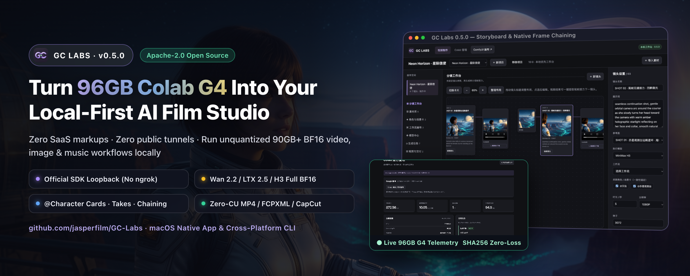


*▲ Live 96GB Colab G4 full-precision showcase project **"Neon Horizon · 星际信使"**: `Qwen Image 2512 BF16` (`1920×1088` keyframe) + `ACE-Step 1.5` (15s original soundtrack) + `MiniMax H3 BF16` (2 frame-chained `1080P` shots) → [**Watch / Download 10s 1080P Showcase Short Film (`neon-horizon-showcase-1080p.mp4`)**](assets/showcase/neon-horizon-showcase-1080p.mp4).*

---

## English Overview

**GC Labs (`0.5.0`)** is a local-first AI video, image, and audio production workstation built around **Google's official `google-colab-cli` SDK** and **ComfyUI**.

Unlike cloud SaaS wrappers that charge high per-minute markups and store your private assets on third-party servers—or fragile Colab notebooks that expose unauthenticated `cloudflared`/`ngrok` public URLs—GC Labs keeps **100% of your projects, reference faces, prompts, credentials, and edits on your own machine**, while treating **96GB Colab G4 (NVIDIA RTX PRO 6000 Blackwell)** runtimes as stateless, on-demand full-precision render engines.

### Why GC Labs?

- **Official SDK Loopback Tunnel (Zero Public Exposure)**: Connects to remote ComfyUI via Google's authenticated kernel transport (`127.0.0.1` only). No `trycloudflare` / `ngrok` URLs, no public port leaks, no ToS tunnel flags.
- **Built for 96GB Full-Precision Video Models**: One-click verified Hugging Face **BF16 / FP16** model presets (`Wan 2.2 A14B FP16`, `LTX 2.5 22B BF16`, `Qwen Image 2512 BF16`, `ACE-Step 1.5 XL BF16`, `MiniMax H3 BF16`) with SHA256 verification and Google Drive persistence—refusing silent quantization downgrades.
- **Conservative GPU Ownership & Zero-Loss Shutdown**: Endpoint-verified session locks (`owned` vs. `external`), **CU Budget Guardrails** (auto-pauses queued shots when your session CU cap is reached without killing active renders), file-by-file SHA256 Drive backup, and verified `drive.flush_and_unmount()` before releasing your GPU.
- **Complete Filmmaking Studio**:
  - **Character / Scene Elements (`@Character`, `@Scene`)**: Anchor visual consistency and reference images across shots.
  - **Multi-Take Gallery & Frame Chaining**: Compare multiple seed takes per shot, pick the Hero Take, and extract exact last/first frames locally to chain continuous shots.
  - **Automatic ComfyUI Canvas-to-API Converter & Git-Locked Custom Nodes**: Drop raw ComfyUI LiteGraph JSONs (including ComfyUI 1.59+ `subgraphs`) straight into the editor, paired with 40-char Git Commit SHA custom node lockfiles.
  - **Rough-Cut Timeline & Pro NLE Delivery**: Preview multi-shot sequences with audio sync and export hardware-encoded **MP4**, **Final Cut Pro / DaVinci Resolve `FCPXML 1.10`**, or **CapCut / Jianying Draft `.zip`** locally with zero cloud compute.
  - **Opt-In Read-Only Mobile Monitor**: Scan a locally generated SVG QR code over LAN / Tailscale to check CU burn and sampling steps (`Step N/M`) from your phone with zero write permissions.

---

## 中文说明

**GC Labs（`0.5.0`）** 是一款**本地优先（Local-First）的 AI 影视分镜与 ComfyUI 云端算力工作站**。原生提供 macOS Apple Silicon 独立客户端（内置 `AVFoundation` 硬件媒体引擎），同时支持 **macOS / Linux / Windows** 跨平台浏览器本地运行。

### 核心能力一览

1. **Colab G4 算力管家（安全、防丢、不误杀）**
   - **本机官方 OAuth 授权**：凭证按 `0600` 权限保存在官方 `colab-cli` 目录，授权码仅驻留内存，项目备份包绝不含任何账号令牌。
   - **明确会话归属锁**：严格区分本工作站创建的 `G4`、显式接管的网页 `G4` 与外部会话，绝不误停其他任务。
   - **单次会话多镜头顺序队列（Batch Queue）+ CU 预算护栏**：一次热机恢复完整模型后顺序跑完多镜队列；支持设定单次会话最高消耗 CU 上限，达标自动暂停后续排队任务。
   - **实时采样步数 & 一键安全中断 & 手机只读监看**：实时跟踪 `采样第 N / M 步` 与预计剩余时间；支持一键 `/interrupt` 停止当前采样（保留 G4 与已完成资产）；支持局域网 / Tailscale 扫码只读看进度（纯本地生成 SVG 二维码，零控制权限）。
   - **备份核验后关机**：逐文件 SHA256 备份 + `drive.flush_and_unmount()` 刷盘确认成功后才释放 GPU。

2. **影视分镜、一致性资产与工作流画布**
   - **角色/场景参考卡（`✦ 角色与场景卡`）**：创建 `@角色 / @场景 / @道具` 一致性卡片，分镜勾选后自动拼入外观提示词并继承默认参考图。
   - **多抽卡挑片（Takes）与尾帧接力（Frame Chaining）**：同一分镜多次生成自动归入候选列表，一键切换“★ 当前采用版”；支持一键提取视频高清尾帧/首帧接力下一镜头参考图。
   - **原始画布一键转 API & G4 全精度一键预设**：直接导入 ComfyUI 画布 JSON（自动展开 1.59+ `subgraphs` 子图）或一键载入内置 **Wan 2.2、LTX 2.5、Qwen Image 2512、ACE-Step 1.5** 官方模板，自动升级并填充经核实的官方 Hugging Face 完整精度（BF16/FP16）权重清单；支持 **40 位固定 Commit SHA** 自定义节点锁文件。

3. **多轨粗剪与专业剪辑交付（零云端算力消耗）**
   - **`▤ 粗剪与交付`**：按镜头顺序联播预览、入出点裁剪、叠加配乐/配音同步试看。
   - 一键本地导出 **MP4 粗剪成片**、**Final Cut Pro / 达芬奇 `FCPXML 1.10`** 时间线及 **剪映专业版 / CapCut 自包含草稿包（`.zip`）**。

---

## 实测全流程演示 / 10-Step Live G4 Production Tour

以下 10 张 Retina 2x 截图完整记录了一次在 **96GB Colab G4** 上从零制作 10 秒 `1080P` 原创有声科幻样片《Neon Horizon · 星际信使》并核验关机的全过程：

### Step 01 · Colab G4 实时算力管家、CU 预算护栏与手机只读监看
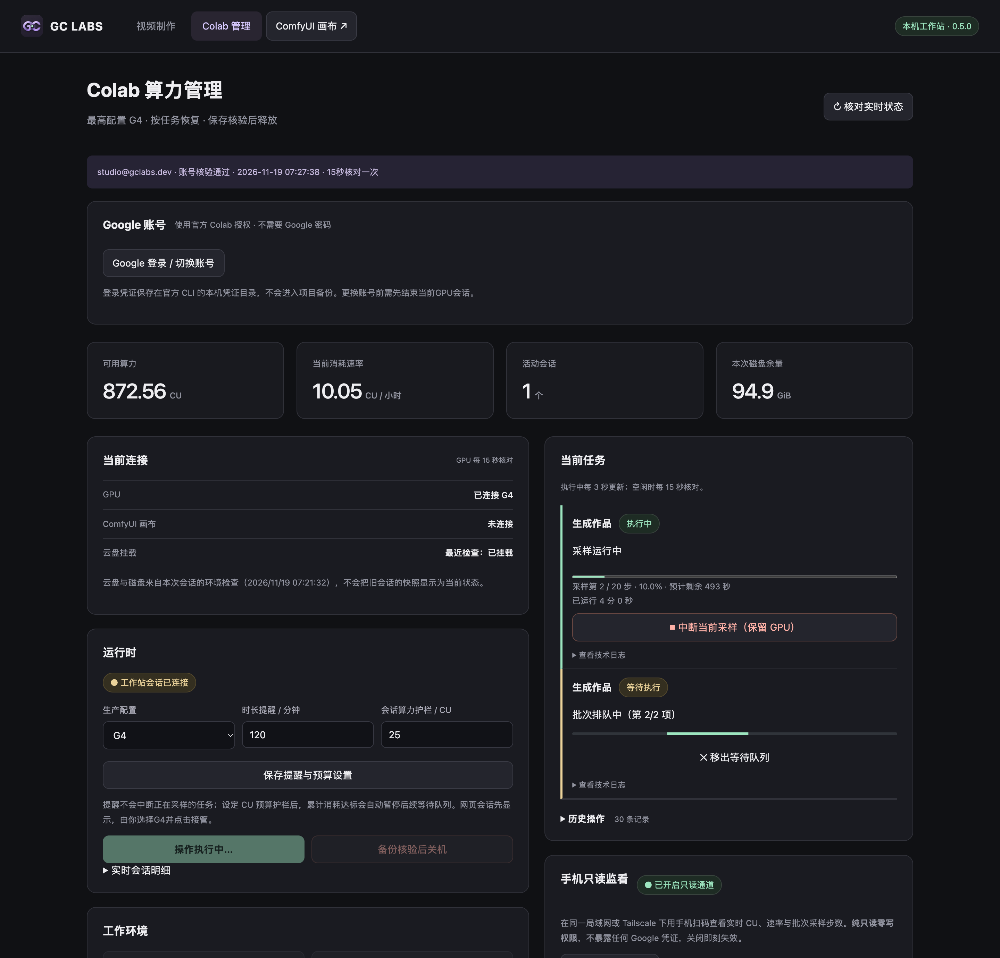

### Step 02 · 官方 ComfyUI 画布一键转 API 与 G4 全精度 `BF16` 预设
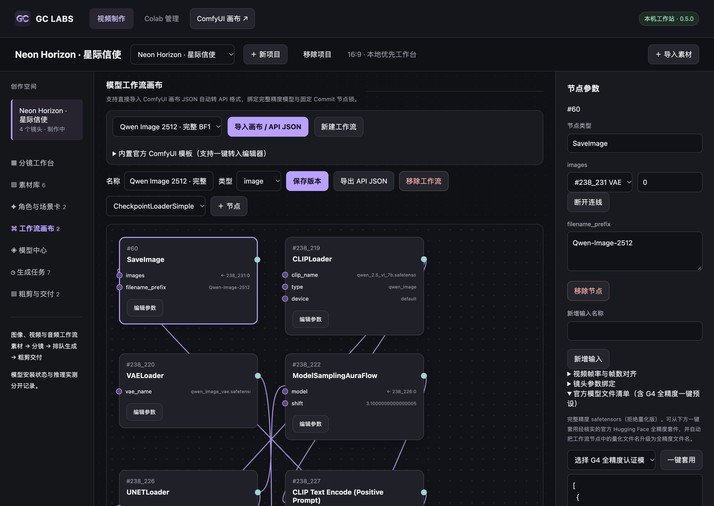

### Step 03 · `Qwen Image 2512 BF16` 首帧概念图与 `ACE-Step 1.5` 原创配乐产出
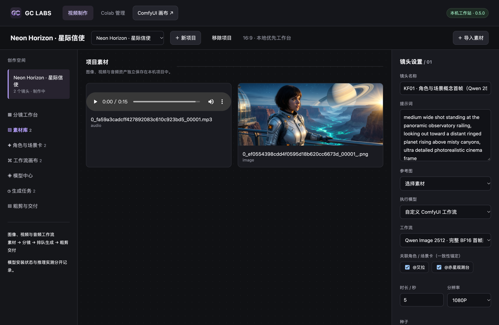

### Step 04 · `@艾拉` 与 `@赤星观测台` 角色/场景一致性资产卡锚定
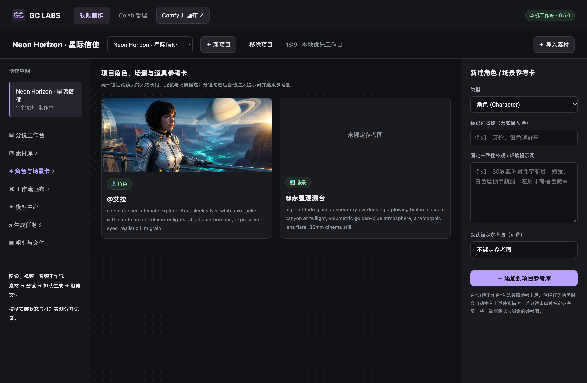

### Step 05 · 从个人云盘高速恢复 `90.85 GiB` `MiniMax H3` 完整 `BF16` 模型
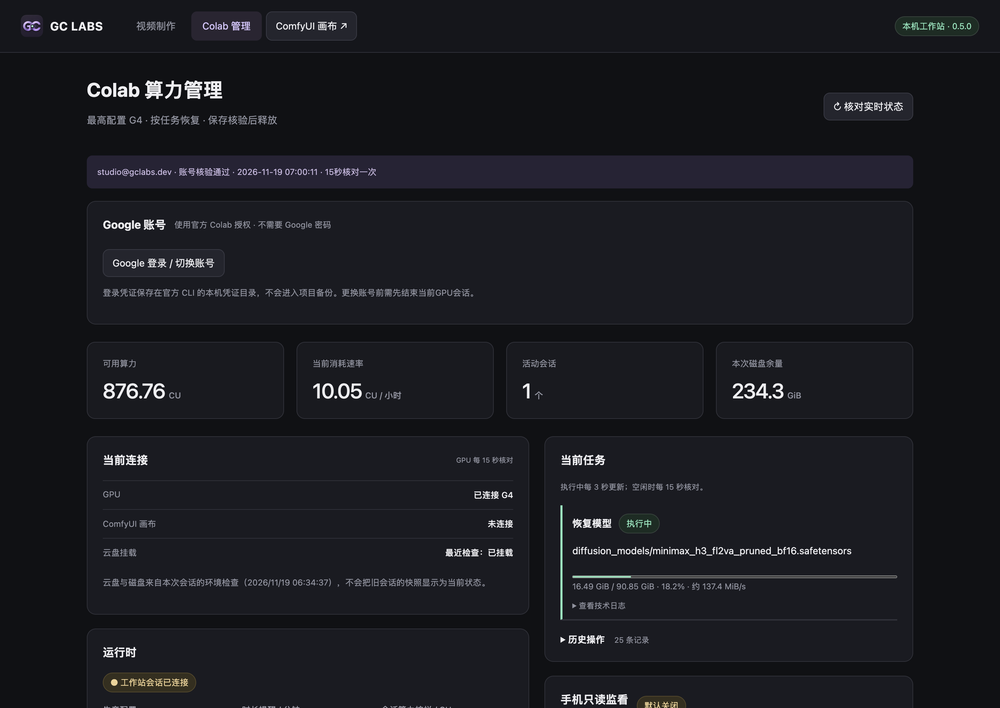

### Step 06 · 同分镜多抽卡顺序队列（FIFO Batch Queue）与实时采样步数
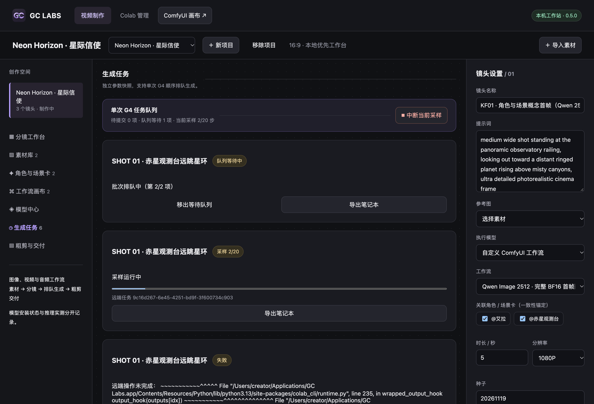

### Step 07 · 多版本抽卡对比挑片（Multi-Take Hero Selection）
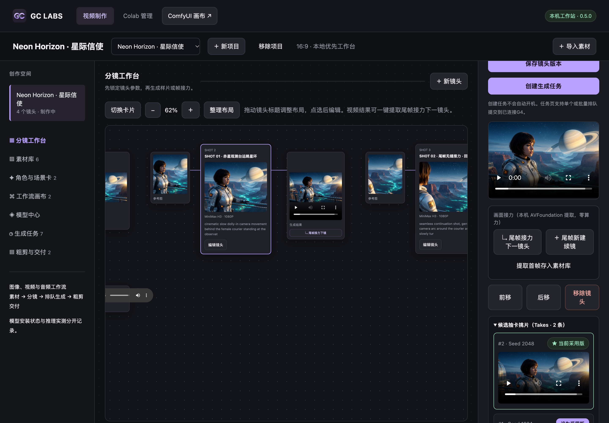

### Step 08 · 本机 `AVFoundation` 提取尾帧无缝接力下一镜头（Frame Chaining）
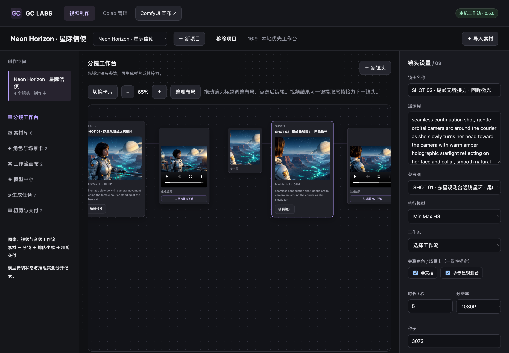

### Step 09 · 本机零算力多轨粗剪合成与 Final Cut / 剪映时间线交付
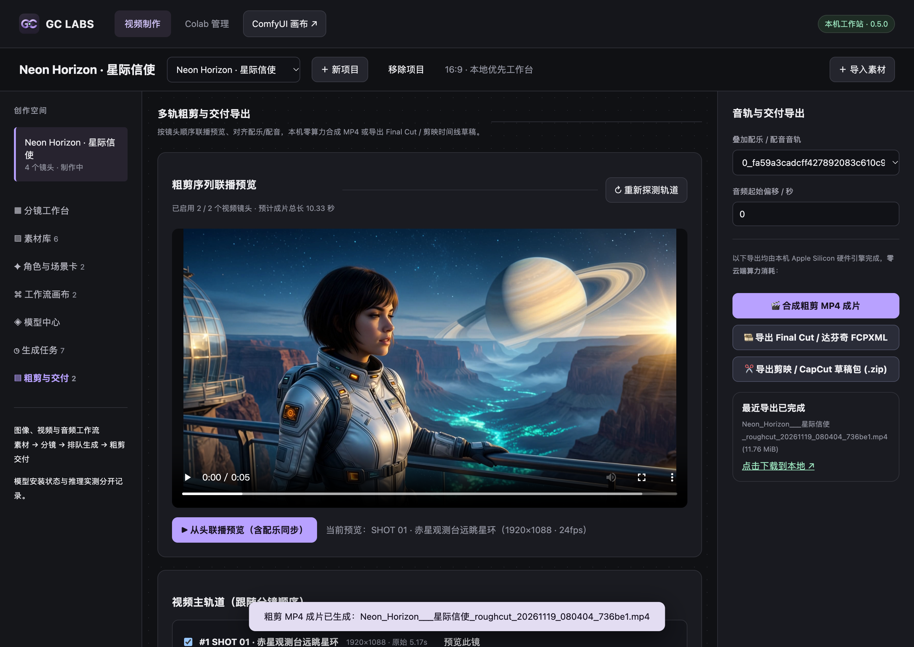

### Step 10 · SHA256 云盘备份核验、刷盘卸载与 G4 安全释放（`0.00 CU/h`）
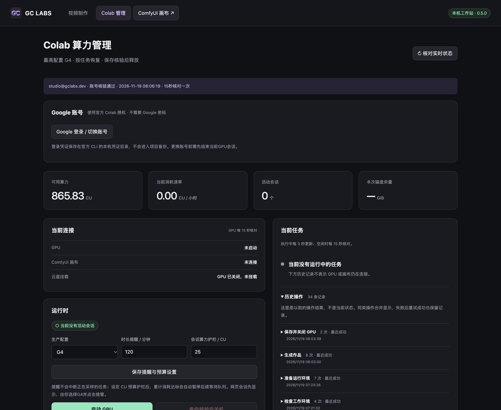

---

## 快速开始 / Quick Start

### 方式一：macOS Apple Silicon 原生客户端
从 [GitHub Releases](../../releases) 下载最新 `GC-Labs-0.5.0-arm64-beta.dmg`，将 `GC Labs.app` 拖入 `Applications`（或 `~/Applications`）即可直接运行（已内置 Python 3.13、`google-colab-cli` 与 `AVFoundation` 硬件媒体组件）。
> *注：开源内测包使用本地 ad-hoc 签名，首次在另外一台 Mac 下载打开如遇系统提示，可在“系统设置 → 隐私与安全性”点击“仍要打开”或执行 `xattr -cr "/Applications/GC Labs.app"`。*

### 方式二：跨平台源码启动（macOS / Linux / Windows）

```sh
pip install google-colab-cli aiohttp
python3 gclabs_cli.py
```
启动后将自动在默认浏览器打开 `http://127.0.0.1:8766/manager`。

### 运行自动化测试与本地构建

```sh
# 运行全部 Python 安全、工作流、预算护栏与媒体单元测试（零云端算力消耗）
PYTHONDONTWRITEBYTECODE=1 python3 -B -m unittest -q test_safety test_console test_gclabs test_workflows test_v040 test_v050

# 运行全部 9 组前端状态机与模块化界面回归测试
for t in test_console_ui.cjs test_runtime_ui.cjs test_live_status.cjs test_compare.cjs test_editor_ui.cjs test_progress_ui.cjs test_disclosure_ui.cjs test_v040_ui.cjs test_v050_ui.cjs; do node "$t"; done

# 构建 macOS 原生应用与 DMG 安装包（仅限 macOS Apple Silicon）
PYTHONDONTWRITEBYTECODE=1 python3 -B macos/build_app.py
PYTHONDONTWRITEBYTECODE=1 python3 -B macos/package_beta.py
```

---

## 内置官方工作流模板致谢 / Bundled Workflow Templates

仓库内置的四份基础画布模板来自 [Comfy-Org/workflow_templates](https://github.com/Comfy-Org/workflow_templates)，固定提交与 SHA256 记录于 [`assets/workflow-templates/sources.json`](assets/workflow-templates/sources.json)，保留原始许可证。Google Colab 为 Google LLC 服务商标，GC Labs 为独立的本地开源客户端项目。

## License

Released under the [Apache-2.0 License](LICENSE).
