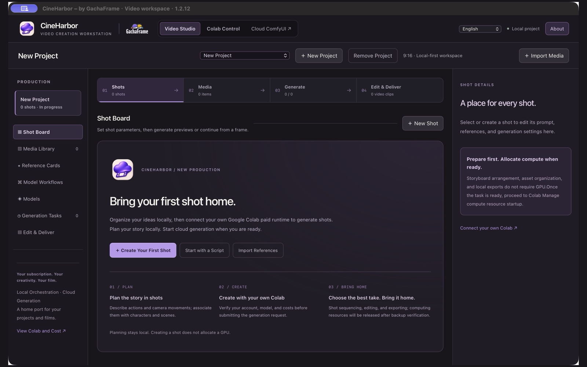
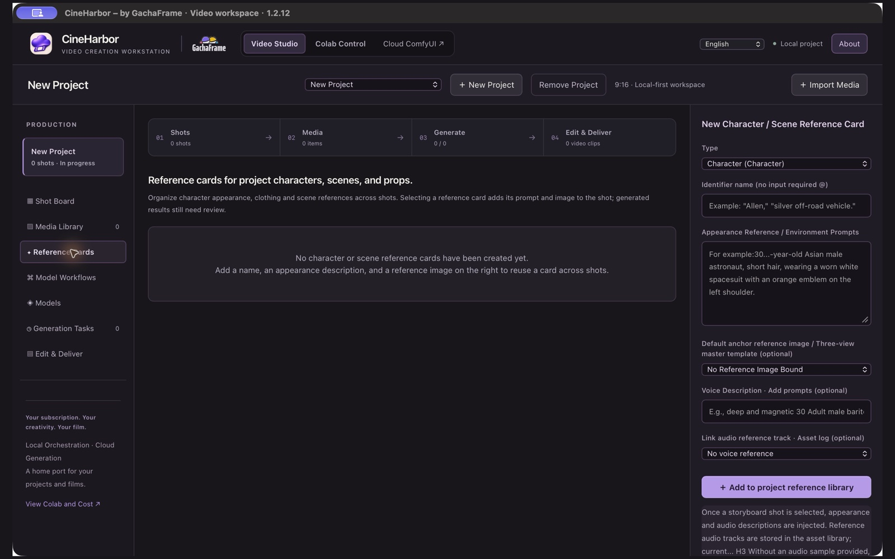

# CineHarbor

A local-first video production workspace for macOS, formerly GC Labs. Plan shots and references on your Mac, generate with your own Google Colab runtime, and cut the selected takes into a finished video.

[简体中文](README.zh-CN.md) · [Build 32 release notes](https://github.com/jasperfilm/CineHarbor/releases/tag/v1.2.12-b32-h3) · [Download the Apple Silicon DMG](https://github.com/jasperfilm/CineHarbor/releases/download/v1.2.12-b32-h3/CineHarbor-1.2.12-Build32-arm64.dmg)

Requires macOS 13 or later. This GitHub development build uses ad-hoc signing and has not been notarized by Apple.

## What you can do

| Stage | In CineHarbor |
| --- | --- |
| Plan | Break a script into shots, write prompts, and attach reference images and character or scene cards. |
| Prepare | Browse model candidates, import ComfyUI canvas or API JSON, and define model files and pinned custom nodes. Templates can be inspected locally. |
| Generate | Connect an eligible Google Colab runtime, prepare its environment, and submit shots individually or in a batch. Review multiple takes and extract the last frame to continue the next shot. |
| Edit and export | Arrange accepted clips on the timeline, trim them, add music and subtitles, and export an MP4 on your Mac. |
| Back up and stop | Save and verify results in your Google Drive before releasing the runtime managed by CineHarbor. |

Use **Media Library** and **Reference Cards** to reuse visual references across shots.

## Models and workflows

**This GitHub development release is 1.2.12 Build 32**, the development version with a built-in MiniMax H3 image-to-video adapter. The H3 restore flow reads a compatible BF16 model backup and manifest from your own Drive. Check the [MiniMax H3 license](assets/licenses/models/MiniMax-H3-LICENSE.txt) for eligible uses and regions.

The workflow library includes Wan 2.2, LTX 2.5, Qwen Image, Qwen Image Edit, and ACE-Step templates. A template defines a workflow. The actual model files, installed nodes, and compute still need to be available in the selected runtime.

## Final cut

Use **Edit & Deliver** to assemble your chosen takes with sound and subtitles, then export locally.

## Get started

For the macOS build, use Apple Silicon, macOS 13 or later, Python 3.13, and Xcode command-line tools.

1. Install the [official Google Colab CLI](https://github.com/googlecolab/google-colab-cli) for cloud use and the local bridge dependencies listed in [requirements-local.lock](macos/requirements-local.lock).
2. Run `python -B server.py` from the source directory and open [the local workspace](http://127.0.0.1:8766). You can create a project and review workflows before allocating a GPU.
3. For a native development build, set `GC_LABS_SDK_PYTHON` to the Python executable in your CLI environment and supply the separately licensed ComfyUI frontend 1.59.1 archive as `vendor/comfy_frontend.zip`. See [component source references](assets/licenses/component-sources.json). Run `python -B macos/build_app.py --stage-only` to stage the app.

Cloud tasks use your own eligible paid Google Colab service. G4 availability and compute charges depend on your account and [Google Colab's limits](https://research.google.com/colaboratory/faq.html). Closing CineHarbor does not stop the runtime. Use **Save and shut down GPU** when your work is finished.

The source release contains code, templates, and documentation. Model weights are supplied separately under their upstream terms. Workspace code is Apache-2.0. Third-party notices and source references are in [assets/licenses](assets/licenses).

CineHarbor is an independent GachaFrame project. Support: contact@gachaframe.com.
