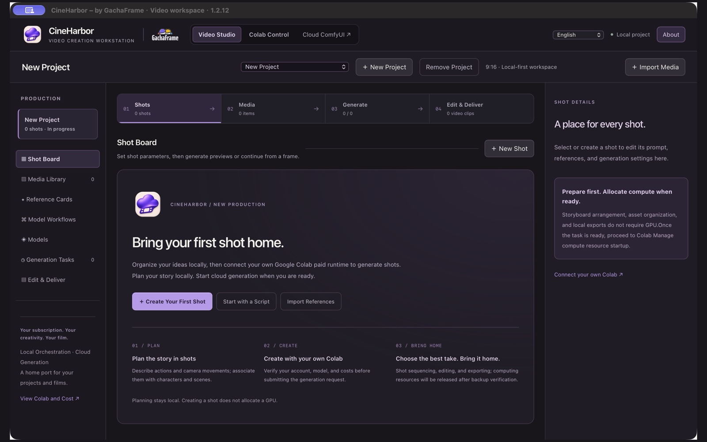
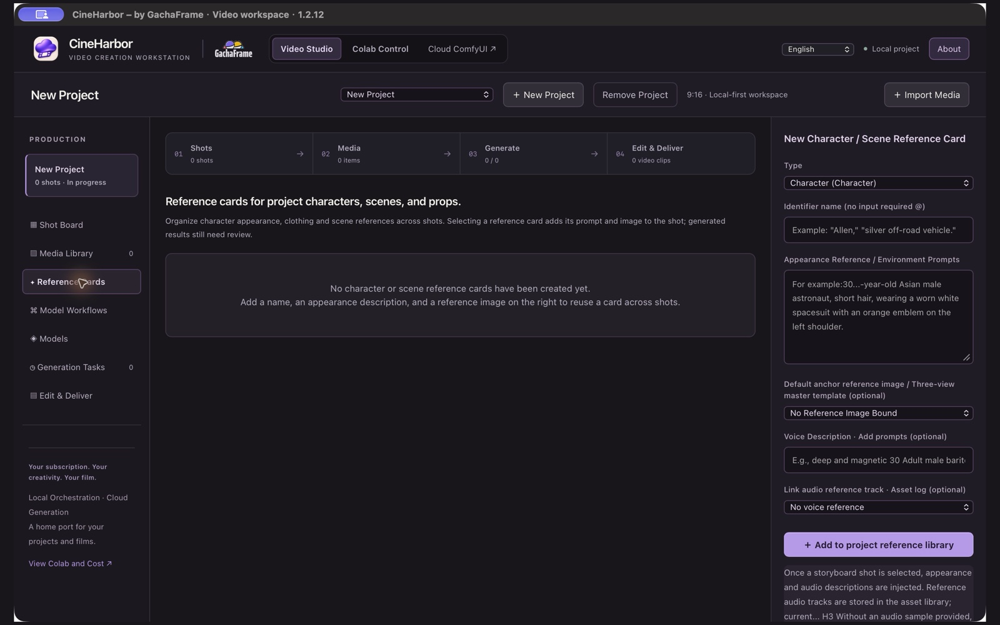
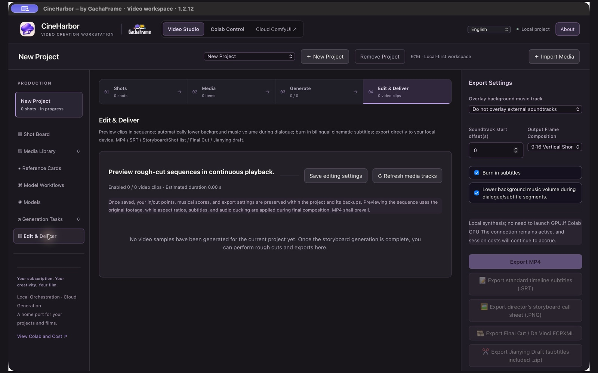

# CineHarbor

CineHarbor（原 GC Labs）是一款面向 macOS 的本地优先视频制作工作台。从写分镜、整理参考素材，到连接自己的 Google Colab 生成镜头，再回到 Mac 选片、剪辑和导出。

[English](README.md) · [Build 32 版本说明](https://github.com/jasperfilm/CineHarbor/releases/tag/v1.2.12-b32-h3) · [下载 Apple Silicon 安装包](https://github.com/jasperfilm/CineHarbor/releases/download/v1.2.12-b32-h3/CineHarbor-1.2.12-Build32-arm64.dmg)

需要 macOS 13 或更新版本。此 GitHub 开发版采用临时签名，尚未通过 Apple 公证。

## 制作流程

1. **分镜与参考素材**。拆解剧本，为每个镜头写提示词、选参考图，并复用角色卡和场景卡。
2. **模型与工作流**。在本机导入 ComfyUI 画布或 API JSON，也可从内置模板开始，配置模型文件和自定义节点版本。
3. **云端生成**。连接你有权使用的 Google Colab 运行时，准备环境和模型，再按单镜头或批次提交。生成后可挑选样片，把上一段的尾帧作为下一镜的参考。
4. **剪辑和导出**。在本机整理镜头顺序和入出点，加入配乐和字幕，导出 MP4。
5. **保存并释放算力**。完成后可把成果备份到自己的 Google Drive，校验通过后再释放由 CineHarbor 管理的运行时。

## 模型支持

**GitHub 开发版为 1.2.12 Build 32。** 这一版内置 MiniMax H3 图生视频适配，可从自己的 Drive 恢复兼容的 BF16 权重备份。恢复流程需要配套模型清单。使用前请核对 [MiniMax H3 原始许可](assets/licenses/models/MiniMax-H3-LICENSE.txt)。

内置工作流模板还覆盖 Wan 2.2、LTX 2.5、Qwen Image、Qwen Image Edit 和 ACE-Step。模板提供工作流，实际生成取决于当前运行时的模型文件、节点及算力。

完整精度预设目前是 6 套：Wan 2.2 I2V FP16、LTX 2.5 22B BF16、Qwen Image 2512 BF16、Qwen Image Edit 2511 BF16、ACE-Step 1.5，以及 ACE-Step 1.5 XL。

## 浏览器模式（macOS、Linux、Windows）

macOS、Linux 和 Windows 可用 `python -B gclabs_cli.py` 在默认浏览器打开本地工作台。Google Colab 云端操作需要 macOS 或 Linux 上的官方 CLI。探测视频、提取尾帧和渲染 MP4 需要 Apple Silicon Mac 的 AVFoundation 媒体组件。

在 Python 3.12 或更新版本的虚拟环境中，从源码目录执行 `python -m pip install .`，之后可用 `cineharbor` 或旧命令 `gclabs` 启动。开发时也可执行 `python -m pip install -e .`。Python 发行名沿用 `gc-labs`，方便原地升级。同版本覆盖安装可用 `python -m pip install --force-reinstall .`。如果要用另行准备的本地 ComfyUI 前端或自己编译的 Mac 媒体组件，请从包含这些依赖的源码目录运行启动器。

`--port` 默认 8766，`--page studio` 打开分镜台，`--no-browser` 不自动打开浏览器，`--data-dir` 指定数据目录。环境变量 `CINEHARBOR_DATA` 优先；未设置时仍接受原来的 `GC_LABS_DATA`。

已有数据目录保持不变：macOS 为 `~/Library/Application Support/Jasper Workstation`，Windows 为 `%APPDATA%\GC Labs`，Linux 为 `~/.local/share/gc-labs`。如果以前用 `python -B server.py`，项目默认在源码目录的 `data/` 中。改用浏览器启动器时，使用 `--data-dir` 指向原目录。原生 Mac App 继续使用原有的 Application Support 路径。

## 从源码开始

从源码运行，包括上面的浏览器启动器，需要 Python 3.12 或更新版本，与 `google-colab-cli` 的要求一致。源码包在 macOS 和 Linux 固定使用与当前登录流程兼容的 Colab CLI 0.7.5。打包原生 macOS App 时，在 Apple Silicon 上准备 macOS 13 或更新系统、Xcode 命令行工具和 CPython 3.13，因为安装包会拷贝这份 3.13 运行时。《[英文说明](README.md#get-started)》列出了本地启动与构建步骤。云端功能使用自己的 Google Colab 账号，机型供应与费用遵循 [Google Colab 的规则](https://research.google.com/colaboratory/faq.html)。退出应用后，已启动的云端运行时仍可能继续运行。

源码版含工作流模板、许可及说明。模型权重需按上游许可取得。联系支持可使用 contact@gachaframe.com。
