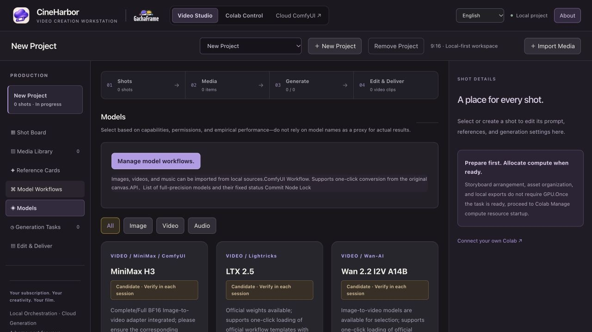
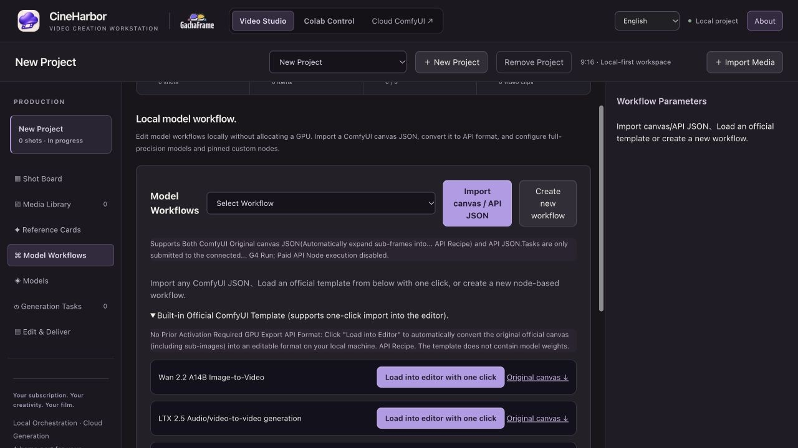

# CineHarbor

CineHarbor（原 GC Labs）是一款面向 macOS 的本地优先视频制作工作台。从写分镜、整理参考素材，到连接自己的 Google Colab 生成镜头，再回到 Mac 选片、剪辑和导出。

[English](README.md) · [Build 32 版本说明](https://github.com/jasperfilm/CineHarbor/releases/tag/v1.2.12-b32-h3) · [下载 Apple Silicon 安装包](https://github.com/jasperfilm/CineHarbor/releases/download/v1.2.12-b32-h3/CineHarbor-1.2.12-Build32-arm64.dmg)

需要 macOS 13 或更新版本。此 GitHub 开发版采用临时签名，尚未通过 Apple 公证。

## 制作流程

1. **分镜与参考素材**。拆解剧本，为每个镜头写提示词、选参考图，并复用角色卡和场景卡。
2. **模型与工作流**。在本机导入 ComfyUI 画布或 API JSON，也可从内置模板开始，配置模型文件和自定义节点版本。
3. **云端生成**。连接你有权使用的 Google Colab 运行时，准备环境和模型，再按单镜头或批次提交。生成后可挑选样片，把上一段的尾帧作为下一镜的参考。
4. **剪辑和导出**。在本机整理镜头顺序和入出点，加入配乐和字幕，导出 MP4。
5. **保存并释放算力**。完成后可把成果备份到自己的 Google Drive，校验通过后再释放由 CineHarbor 管理的运行时。

## 模型支持

**GitHub 开发版为 1.2.12 Build 32。** 这一版内置 MiniMax H3 图生视频适配，可从自己的 Drive 恢复兼容的 BF16 权重备份。恢复流程需要配套模型清单。使用前请核对 [MiniMax H3 原始许可](assets/licenses/models/MiniMax-H3-LICENSE.txt)。

内置工作流模板还覆盖 Wan 2.2、LTX 2.5、Qwen Image、Qwen Image Edit 和 ACE-Step。模板提供工作流，实际生成取决于当前运行时的模型文件、节点及算力。

## 从源码开始

在 Apple Silicon Mac 上准备 macOS 13 或更新系统、Python 3.13 和 Xcode 命令行工具。《[英文说明](README.md#get-started)》列出了本地启动与构建步骤。云端功能使用自己的 Google Colab 账号，机型供应与费用遵循 [Google Colab 的规则](https://research.google.com/colaboratory/faq.html)。退出应用后，已启动的云端运行时仍可能继续运行。

源码版含工作流模板、许可及说明。模型权重需按上游许可取得。联系支持可使用 contact@gachaframe.com。
